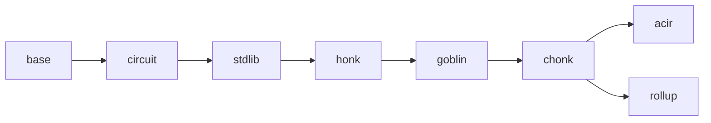

# bb-ref

A minimal Rust reimplementation of [barretenberg]'s proving stack — UltraHonk (+ZK, +Keccak,
+Rollup), Chonk (client IVC: HyperNova + Goblin), and the full rollup recursion — **gate-exact
and byte-exact** against a pinned bb commit. It exists to answer, by construction, *"what is the
actual protocol?"*: separating the proving system's essential content from barretenberg's
engineering, and to stand as an independent implementation that could eventually replace it.

[barretenberg]: https://github.com/AztecProtocol/aztec-packages/tree/master/barretenberg

## Goals

| goal | target | state |
| --- | --- | --- |
| Less code | ≤ 20% of bb's C++ (no AVM, no benchmarks) | **18.5%** implementation-only (`tools/loc.sh`) |
| Bit parity | VKs bit-exact, proofs byte-exact, both directions, incl. the wire protocol | **holds** — 62/62 corpus responses byte-identical; every VK and pinned flow byte-equal |
| Performance | < 1.8× bb, eventually ≤ 1.2× | ~2× on big circuits after removing fixed overheads; per-front work remains (`tools/bench.sh`) |
| Standalone confidence | ~80% coverage of the verifier core without bb, plus soundness (every tamper rejected) | verifier core 95–100%, whole-tree 58% standalone ([docs/testing.md](docs/testing.md)) |

Out of scope, permanently: the AVM (public-transaction execution), Solidity verifier generation,
Starknet oracle hash.

## The pin

bb-ref tracks one bb commit, recorded in [`tools/PIN`](tools/PIN) (a branch carrying a handful of
reviewable test-support commits: the seeded RNG, the frame-draw counter, envelope framing, the
instance dumper). Every doc comment citing a bb source path means *that file at the pin*.
Re-pinning: update the pin, `tools/regen/regen_corpus.sh`, re-run the suites, chase drift
with [docs/oracle.md](docs/oracle.md)'s ladder.

## Layout

One crate; layering is enforced by review, not the build system — each module depends only on
those left of it. Every module directory has a README covering its purpose, how it fits, and how
it works — start at [docs/tour.md](docs/tour.md) for the narrative, descend into the module
READMEs for detail:



| module | contents |
| --- | --- |
| [`base`](src/base) | field/group traits over arkworks, Poseidon2 & Keccak transcripts, codecs, SRS, polynomials |
| [`circuit`](src/circuit) | the one builder (Ultra + Mega), trace blocks, op queue, databus, plookup tables |
| [`stdlib`](src/stdlib) | in-circuit types: `FieldT`, bigfield, biggroup, `cycle_group`, goblin elements |
| [`honk`](src/honk) | flavors-as-data, relations, sumcheck, Shplemini/KZG, Oink, Ultra prover/verifier, HyperNova |
| [`goblin`](src/goblin) | merge, IPA/TripleIPA, ECCVM, Translator |
| [`chonk`](src/chonk) | the IVC driver, joint MegaZK+Translator proof, kernel circuit logic, proof compression |
| [`acir`](src/acir) | ACIR ingestion, protocol-opcode lowering, recursion constraints, write-VK mocks |
| [`rollup`](src/rollup) | backend-side recursion: in-circuit Ultra verifier, IPA accumulation, RollupIO |
| [`msgpack`](src/msgpack) | bb's wire protocol: generated types + the command handler (`bb-ref msgpack run`) |
| [`tests/`](tests) | differential suites (vs `tests/data/` fixtures) + standalone soundness/relations suites |
| [`tools/`](tools) | the commands below, their support libs, and the fixture regenerators |

## Commands

```sh
tools/regen/regen_corpus.sh          # rebuild the corpus from the pinned tree (produce-only)
tools/conformance.sh <corpus.zst>    # replay it into bb-ref vs recorded bb goldens, byte compare
tools/bench.sh <corpus.zst> --both   # per-operation timings, bb vs bb-ref (--threads <n>)
tools/check.sh                       # the standalone gate: unit tests with no bb, corpus, or fixtures
tools/coverage.sh                    # line coverage of the standalone test set
tools/loc.sh [--no-tests]            # bb C++ vs bb-ref Rust, side by side
cargo test --release                 # everything: differential + standalone (~10 min)
```

A **corpus** is the exact wire bytes a real prover sent to bb, replayable into either
implementation with nothing in between — see [tools/README.md](tools/README.md).

## Documentation

- **[docs/tour.md](docs/tour.md)** — start here: "life of a proof", the whole system in four
  acts, almost no math.
- **[docs/gate-exactness.md](docs/gate-exactness.md)** — why the code sometimes computes the same
  thing twice on purpose, and why you must not "clean it up".
- **[docs/oracle.md](docs/oracle.md)** — how correctness is established: differential fixtures,
  the bb-side dumper, the divergence-hunting ladder.
- **[docs/conformance.md](docs/conformance.md)** — the corpus design: capture, replay, seeds and
  thread policy, the msgpack server.
- **[docs/testing.md](docs/testing.md)** — the two-layer test structure (differential vs
  standalone), the soundness checklist, coverage.
