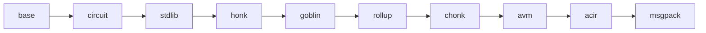

# bb-ref

A minimal Rust reimplementation of [barretenberg]'s proving stack — UltraHonk (+ZK, +Keccak,
+Rollup), Chonk (client IVC: HyperNova + Goblin), and the full rollup recursion — **gate-exact
and byte-exact** against a pinned bb commit. It exists to answer, by construction, *"what is the
actual protocol?"*: separating the proving system's essential content from barretenberg's
engineering, and to stand as an independent implementation that could eventually replace it.

[barretenberg]: https://github.com/AztecProtocol/aztec-packages/tree/master/barretenberg

## Goals

These are the project's binding goals — changes should be judged against them:

| goal | state |
| --- | --- |
| **Minimum lines of code** for a bit-parity reference implementation, in modern idiomatic Rust | **36%** of bb's C++ like for like, **23%** counting tests ([by component](#size)) |
| **A test suite under 30 s**: the default run (`cargo nextest run --release`) keeps every differential test's smallest real cases; `BBREF_FULL=1` adds every full-size byte-exactness case | **6 s**, 200 tests, every fixture required, on the shared dev box under load at nice 19 |
| **Lean on stable, mature dependencies** instead of handwriting (fields/curves: arkworks; msgpack: rmp-serde; parallelism: rayon) | holds, with one deliberate exception: the hot field kernels (ADX and IFMA Montgomery multiply, bb's wasm 29-bit and wide multiplies, Bernstein–Yang inverse) and the MSM are ported from bb for speed; arkworks still supplies the field and curve framework, the pairing and G2 ([src/base](src/base/README.md)) |
| **Bit parity**: VKs bit-exact, proofs byte-exact, both directions, including the wire protocol | holds — every VK, proof and wire response checked is byte-equal, and bb-ref rejects tampered proofs as bb does ([what is checked](#parity)) |
| **Circuit gate parity**: every selector, wire and copy-cycle identical to bb's ([docs/gate-exactness.md](docs/gate-exactness.md)) | holds — 41 stdlib gadget programs compared gate for gate, plus the VK sweeps ([parity](#parity)) |
| **Replay the rollup through bb and bb-ref and get the same root proof** | holds — 63/63 `rollup-1117683` corpus responses byte-identical, `rollup_root` included, and 28/28 of the AVM corpus (prove, check circuit, verify) (`tools/conformance.sh`) |
| **At parity or better with bb in performance, memory usage and wasm size** (against stock bb at the pin) | Chonk time **0.46×** native, **0.68×** wasm; the rollup **0.45×**; the AVM **0.46×**; memory **0.8–0.9×** native, **0.7–0.8×** wasm, and **17–22 MiB** private in [low memory mode](#low-memory-environments) (bb's: 39–101); wasm module **2.1× smaller** ([speed and memory](#speed-and-memory), [binary size](#binary-size)) |
| **Fast to build**: a from-scratch release build well under bb's, like for like | **0.22×** bb's time with the AVM, **0.46×** without, on 16 cores ([build time](#build-time)) |
| **95%+ test coverage on the critical paths**, without redundant tests | core **95%** standalone, plus full soundness sweeps ([docs/testing.md](docs/testing.md)) |
| **Documentation an engineer can descend**: each component's purpose without the math; first use of any odd name links to its explanation | [tour](docs/tour.md) → module READMEs → [glossary](docs/glossary.md) |
| **A maintenance process for bb divergence**: diagnose and resolve drift quickly as bb moves | the pin + regen + divergence ladder ([docs/oracle.md](docs/oracle.md)) |

bb-ref proves and verifies the AVM (public-transaction execution), natively, and verifies it
in-circuit, so it builds and proves the public tx base rollup, which recursively verifies one
through bb's two-layer AVM verifier ([src/avm](src/avm/README.md)). The AVM's simulation and trace
generation stay bb's: native builds with `--features bb-avm` link them in-process
(`libbb-avm-sim.a`: `./pin/build.sh --avm-lib` first; bb's release toolchain, zig 0.15.1, and the
system libc++ to link it) for the three AVM commands, so one binary serves the whole prover. Out of scope at this
time: Solidity verifier generation, Starknet oracle hash.

## Results

### Size

`tools/loc.sh` counts like for like: generated code and benchmarks are out on both sides, and so
are the parts of bb that bb-ref has no counterpart for or links rather than ports. Code lines
without tests (bb's `*.test.cpp`, bb-ref's `tests/`; bb-ref's inline unit tests stay counted):

| component | bb (C++) | bb-ref (Rust) | ratio |
| --- | ---: | ---: | ---: |
| base: fields, curves, MSM, hashes, polynomials, SRS, transcripts | 33,514 | 9,484 | 28% |
| honk: flavors, relations, sumcheck, PCS, Ultra, HyperNova | 21,787 | 7,187 | 33% |
| stdlib + rollup: in-circuit types and verifiers | 19,896 | 8,889 | 45% |
| acir: ACIR ingestion and opcode lowering | 14,901 | 2,399 | 16% |
| goblin: merge, IPA, ECCVM, Translator | 7,328 | 5,757 | 79% |
| circuit: the builders, op queue, plookup tables | 7,046 | 4,309 | 61% |
| msgpack + CLI: the wire protocol server | 6,249 | 1,110 | 18% |
| avm: prover, verifier, circuit check | 4,237 | 1,807 | 43% |
| chonk: the client IVC | 3,371 | 1,463 | 43% |
| **total** | **118,396** | **42,445** | **36%** |

With tests on both sides it is 46,659 against 204,479 lines (**23%**). Left out of bb's count: the
AVM's simulation and trace generation (27,928 lines, which bb-ref links from bb), the AVM fuzzer
and the node module (19,836), SMT and formal verification, analysis tools, world-state DBs,
Solidity and Starknet (7,477), and vendored CLI11.

### Speed and memory

Chonk (client IVC) proving over the 11 pinned transaction flows, stock bb at the pin against
bb-ref, both seeded, 8 threads, on a 16-core Zen 4 box (bbbench). Time is wall, best of 3; ratio is
bb-ref / bb, below 1 is better. Wasm runs under V8 (node 24, worker threads and shared memory, the
browser's shape); its memory is the wasm linear-memory peak, native's is peak RSS. Every bb-ref
proof is byte-identical to bb's. Tables of record in [bench-results/](bench-results/), method in
[docs/performance.md](docs/performance.md).

| flow | native bb | bb-ref | ratio | native mem bb | bb-ref | wasm bb | bb-ref | ratio | wasm mem bb | bb-ref |
| --- | ---: | ---: | ---: | ---: | ---: | ---: | ---: | ---: | ---: | ---: |
| deploy_ecdsar1 | 3.12 s | 1.52 s | 0.49× | 0.25 GB | 0.22 GB | 5.68 s | 4.29 s | 0.76× | 0.23 GB | 0.18 GB |
| deploy_schnorr | 2.89 s | 1.40 s | 0.48× | 0.28 GB | 0.22 GB | 5.31 s | 4.02 s | 0.76× | 0.22 GB | 0.18 GB |
| amm_add_liquidity_1_recursions | 4.76 s | 2.37 s | 0.50× | 0.26 GB | 0.22 GB | 8.58 s | 6.28 s | 0.73× | 0.23 GB | 0.19 GB |
| ecdsar1 deploy_tokenContract | 3.66 s | 1.73 s | 0.47× | 0.26 GB | 0.23 GB | 6.50 s | 4.87 s | 0.75× | 0.24 GB | 0.19 GB |
| storage_proof_7_layers | 10.42 s | 4.00 s | 0.38× | 0.70 GB | 0.56 GB | 22.22 s | 10.67 s | 0.48× | 0.66 GB | 0.48 GB |
| token_bridge_claim_private | 3.16 s | 1.53 s | 0.48× | 0.26 GB | 0.22 GB | 5.83 s | 4.35 s | 0.75× | 0.23 GB | 0.19 GB |
| transfer_0_recursions, private_fpc | 4.16 s | 2.02 s | 0.49× | 0.26 GB | 0.23 GB | 7.45 s | 5.50 s | 0.74× | 0.24 GB | 0.19 GB |
| transfer_0_recursions | 2.76 s | 1.33 s | 0.48× | 0.25 GB | 0.21 GB | 5.10 s | 3.87 s | 0.76× | 0.22 GB | 0.18 GB |
| transfer_1_recursions, private_fpc | 4.43 s | 2.14 s | 0.48× | 0.26 GB | 0.22 GB | 7.83 s | 5.77 s | 0.74× | 0.25 GB | 0.19 GB |
| transfer_1_recursions | 3.07 s | 1.46 s | 0.48× | 0.25 GB | 0.22 GB | 5.59 s | 4.22 s | 0.75× | 0.22 GB | 0.18 GB |
| schnorr deploy_tokenContract | 3.40 s | 1.62 s | 0.48× | 0.27 GB | 0.23 GB | 6.08 s | 4.59 s | 0.75× | 0.23 GB | 0.19 GB |
| **total** | **45.83 s** | **21.12 s** | **0.46×** | | | **86.17 s** | **58.43 s** | **0.68×** | | |

Flows use the sponsored fee payer unless marked `private_fpc`, and an ecdsar1 account unless
marked schnorr. With wasm wide arithmetic (node 27 nightly), bb-ref's wasm total drops to 0.56×.

On ARM (Graviton4, 16 vCPU, 8 threads; bb built with its `arm64-linux` preset), native wall
**0.80×** bb over the same flows (sum of best walls 31.59 s against 41.04 s; 0.66–0.82× per flow),
peak RSS 0.20–0.55 GB against 0.23–0.65 GB ([bench-results/arm-graviton.txt](bench-results/arm-graviton.txt)).

The rollup and AVM corpora (real recorded server traffic, `tools/bench.sh --pair`), native, 16
threads, the same box, replayed through bb-avm and then bb-ref (with the AVM) one after the other
([bench-results/rollup.txt](bench-results/rollup.txt)):

| corpus operation | n | bb | bb-ref | ratio |
| --- | ---: | ---: | ---: | ---: |
| PrivateTxBaseRollup prove | 9 | 103.86 s | 42.63 s | 0.41× |
| RootRollup prove | 2 | 64.57 s | 30.98 s | 0.48× |
| CheckpointRootRollup prove | 2 | 46.23 s | 21.27 s | 0.46× |
| CheckpointRootSingleBlockRollup prove | 2 | 40.80 s | 18.50 s | 0.45× |
| the other 8 rollup circuits' proves | 15 | 44.89 s | 21.79 s | 0.49× |
| BbCircuitVerify | 32 | 0.52 s | 0.43 s | 0.83× |
| BbInit | 1 | 0.00 s | 0.00 s | |
| **rollup total** (peak RSS 12.02 GB → 11.24 GB) | **63** | **300.89 s** | **135.61 s** | **0.45×** |
| BbAvmProve | 7 | 57.26 s | 27.61 s | 0.48× |
| BbAvmCheckCircuit | 7 | 29.71 s | 12.22 s | 0.41× |
| BbAvmVerify | 14 | 1.77 s | 1.42 s | 0.80× |
| **AVM total** (peak RSS 12.62 GB → 10.14 GB) | **28** | **88.74 s** | **41.25 s** | **0.46×** |

The AVM's simulation and trace generation are bb's own code in both binaries, so its rows compare
the proving and checking around them, and how fast the trace reaches them.

Try it in a browser: **[charlielye.github.io/bb-ref](https://charlielye.github.io/bb-ref/)** proves
the same flows with both engines side by side ([js/](js/README.md)).

### Low memory environments

For phones and other memory-limited hosts, `--slow_low_memory` (bb's flag, also
`BB_SLOW_LOW_MEMORY=1`) proves every pinned Chonk flow in **17–22 MiB of private memory, at 2% extra
wall**. bb's own low memory mode at
[aztec-packages#25732](https://github.com/AztecProtocol/aztec-packages/pull/25732) needs 39–101 MiB
at 9% extra, and stock bb 220–648 MiB. Private memory is what iOS's footprint counts, and what an
app extension's limit is enforced against (a keyboard's: 77 MB on an iPhone 13).

The mode puts every allocation of 64 KiB or more (polynomials, the builder's vectors, MSM scratch)
in an unlinked temp file mapped shared, where bb's puts only polynomials. Those blocks are file pages:
the kernel can write them back and drop them, so they are outside the footprint. They are not
gone. A proof keeps about as much resident as normal mode does (~226 MiB on the transfer flow).
While the device has that much free it runs at full speed, and most of the data never reaches
the disk before the file is deleted. Under memory pressure the kernel reclaims those pages first
and the proof slows down
([docs/performance.md](docs/performance.md#allocator-and-runtime)).

Peak private memory (`tools/footprint.sh`) and wall, uncapped, 6 threads (an iPhone 13's cores),
against stock bb and bb #25732 with `--slow_low_memory`, on a Zen 2 box with the temp files on
local NVMe ([bench-results/low-memory.txt](bench-results/low-memory.txt)):

| flow | bb | bb #25732 low | bb-ref | bb-ref low |
| --- | ---: | ---: | ---: | ---: |
| deploy_ecdsar1 | 4.77 s, 232 MiB | 5.21 s, 41 MiB | 3.21 s, 191 MiB | 3.22 s, **18 MiB** |
| deploy_schnorr | 4.37 s, 224 MiB | 4.87 s, 39 MiB | 2.99 s, 189 MiB | 3.04 s, **17 MiB** |
| amm_add_liquidity_1_recursions | 6.96 s, 246 MiB | 7.73 s, 43 MiB | 4.83 s, 197 MiB | 4.92 s, **22 MiB** |
| ecdsar1 deploy_tokenContract | 5.47 s, 230 MiB | 6.01 s, 42 MiB | 3.61 s, 200 MiB | 3.72 s, **22 MiB** |
| storage_proof_7_layers | 15.80 s, 648 MiB | 16.82 s, 101 MiB | 8.52 s, 533 MiB | 8.66 s, **20 MiB** |
| token_bridge_claim_private | 4.70 s, 229 MiB | 5.23 s, 41 MiB | 3.19 s, 195 MiB | 3.22 s, **20 MiB** |
| transfer_0_recursions, private_fpc | 6.10 s, 236 MiB | 6.65 s, 42 MiB | 4.16 s, 198 MiB | 4.22 s, **20 MiB** |
| transfer_0_recursions | 4.16 s, 220 MiB | 4.51 s, 41 MiB | 2.82 s, 188 MiB | 2.88 s, **17 MiB** |
| transfer_1_recursions, private_fpc | 6.40 s, 236 MiB | 7.01 s, 42 MiB | 4.37 s, 196 MiB | 4.50 s, **21 MiB** |
| transfer_1_recursions | 4.59 s, 220 MiB | 5.01 s, 40 MiB | 3.12 s, 187 MiB | 3.19 s, **18 MiB** |
| schnorr deploy_tokenContract | 5.12 s, 231 MiB | 5.54 s, 42 MiB | 3.34 s, 196 MiB | 3.45 s, **20 MiB** |
| **total wall** | **68.4 s** | **74.6 s** | **44.2 s** | **45.0 s** |

**Worst case, no free memory anywhere.** A cgroup cap counts file pages too, so it stands in for a
device with that little memory free in total. The transfer flow at 8 threads then still completes
under a 64–120 MiB cap, depending on the host's disk and kernel, in 15–27 s instead of 2–4 s.
At 1 thread it completes under 20 MiB, in 18 min. bb #25732 needs 208 MiB (`tools/memory_floor.sh`).

The mode is native: glibc Linux now, macOS and iOS next. The browser prover always takes the
memory-lean choices the mode makes natively.

### Build time

A release build from scratch on 16 cores (an EPYC 9R14 bench box, standing in for a workstation),
single run, `tools/build_time.sh`. bb builds with its release preset (zig's clang, libc++) and
`ninja bb-avm` or `ninja bb`; bb-ref with `cargo build --release`, plus `--features bb-avm` for the
AVM. *Own code only* rebuilds each side with its third-party dependencies already built (bb's
`_deps/`; bb-ref's crates, ipc-runtime included). bb-ref's AVM build links bb's simulation and
trace generation (`libbb-avm-sim.a`), which is bb's code: it is built beforehand and not timed,
as bb's prebuilt avm-transpiler is not either.

| | bb | bb-ref | ratio | own code: bb | bb-ref | ratio |
| --- | ---: | ---: | ---: | ---: | ---: | ---: |
| with the AVM | 289 s | 65 s | **0.22×** | 282 s | 52 s | **0.18×** |
| without the AVM | 129 s | 59 s | **0.46×** | 128 s | 48 s | **0.38×** |

### Binary size

Native, stripped, from the same builds: bb-avm is 153.5 MB against bb-ref's 33.6 MB with the AVM
(**4.6× smaller**, bb's linked simulation included); bb is 51.2 MB against 23.6 MB without it
(**2.2×**).

Wasm (what the browser downloads, as published on the [bench page](https://charlielye.github.io/bb-ref/)):
bb.js-api's threads module is 18.15 MB (4.03 MB gzipped); bb-ref.js's, Chonk-only and stripped,
is **8.48 MB (2.05 MB gzipped)**, 2.1× smaller.

### Parity

Every check below runs in the suite (the largest circuits with `BBREF_FULL=1`) or in
`tools/conformance.sh`, against fixtures regenerated from the pin by bb itself ([docs/oracle.md](docs/oracle.md)):

- **VKs.** 486 acir_tests programs, each as an Ultra VK hash and a MegaApp VK; 17 rollup and
  protocol circuits; the 8 private and hiding kernels.
- **Gates.** 41 stdlib gadget programs (bigfield, biggroup, ECDSA, SHA-256, Keccak, Blake2s/3,
  AES, Poseidon2, …): every selector, wire and copy cycle equal to bb's, the first differing row
  reported otherwise ([docs/gate-exactness.md](docs/gate-exactness.md)).
- **Proofs.** Byte-identical to bb's: the 11 pinned Chonk flows, seeded; the ZK provers (Ultra ZK,
  ECCVM, the joint MegaZK + Translator proof, Chonk) on bb's recorded randomness; every non-ZK
  proof outright.
- **The wire.** The rollup corpus (a whole epoch as a real prover sent it to bb) gets 63/63
  responses byte-identical, the root rollup included; the AVM corpus 28/28 (prove, check circuit,
  verify).
- **Rejection.** All 32 rollup proofs bb accepted, replayed with a public input changed, are
  rejected with bb's answer; the AVM corpus carries its own tampered verifies.

## The pin

bb-ref tracks one bb commit, recorded in [`tools/PIN`](tools/PIN): `cl/bb-ref-conformance`, bb's
`next` (at 2be71b2f5d, with the private-repo security batch) plus the generated bb.js-api package
and its `Init` command and wide-arithmetic modules (aztec-packages#25433), carrying a handful of
reviewable test-support commits (the seeded RNG and its draw tape, the frame-draw counter, envelope
framing, the instance dumper) and one fix to ipc-runtime's node wasm threads. Every doc comment citing a bb source path means *that file at the pin*.
Re-pinning: follow [docs/oracle.md § Re-pinning](docs/oracle.md#re-pinning), then chase drift
with its ladder.

## Layout

One crate; layering is enforced by review, not the build system — each module depends only on
those left of it, apart from test code and sumcheck's Translator hook. Every module directory has a README covering its purpose, how it fits, and how
it works — start at [docs/tour.md](docs/tour.md) for the narrative, descend into the module
READMEs for detail:



| module | contents |
| --- | --- |
| [`base`](src/base/README.md) | field/group traits over arkworks, Poseidon2 & Keccak transcripts, codecs, SRS, polynomials |
| [`circuit`](src/circuit/README.md) | the one builder (Ultra + Mega), trace blocks, op queue, databus, plookup tables |
| [`stdlib`](src/stdlib/README.md) | in-circuit types: `FieldT`, bigfield, biggroup, `cycle_group`, goblin elements |
| [`honk`](src/honk/README.md) | flavors-as-data, relations, sumcheck, Shplemini/KZG, Oink, Ultra prover/verifier, HyperNova |
| [`goblin`](src/goblin/README.md) | merge, IPA/TripleIPA, ECCVM, Translator |
| [`chonk`](src/chonk/README.md) | the IVC driver, joint MegaZK+Translator proof, kernel circuit logic, proof compression |
| [`acir`](src/acir/README.md) | ACIR ingestion, protocol-opcode lowering, recursion constraints, write-VK mocks |
| [`avm`](src/avm/README.md) | the AVM prover, verifier (native and in-circuit: bb's two-layer recursive verifier) and circuit check, over relation tables generated from bb-pilcom's output |
| [`rollup`](src/rollup/README.md) | backend-side recursion: in-circuit Ultra verifier, IPA accumulation, RollupIO |
| [`msgpack`](src/msgpack/README.md) | bb's wire protocol: generated types + the command handler (`bb-ref msgpack run`) |
| [`tests/`](tests) | differential suites (vs `tests/data/` fixtures) + standalone soundness/relations suites |
| [`tools/`](tools/README.md) | the commands below, their support libs, and the fixture regenerators |
| [`js/`](js/README.md) | `bb-ref.js` (generated: bb.js-api's API over bb-ref's module) and a browser bench page comparing the two ([live](https://charlielye.github.io/bb-ref/)) |

## Commands

```sh
tools/regen/regen_corpus.sh          # rebuild the corpus from the pinned tree (produce-only)
tools/conformance.sh                 # replay the rollup and AVM corpora into bb-ref vs bb's goldens
tools/bench.sh <corpus.zst> --both   # per-operation timings, bb vs bb-ref (--threads <n>)
tools/bench_chonk.sh                 # client-IVC proving over the pinned tx flows, bb vs bb-ref
tools/bench_chonk_wasm.sh v8         # the same on wasm (v8 or wasmtime)
tools/check.sh                       # the standalone gate: warning-free build + unit tests, no bb or fixtures
tools/coverage.sh                    # line coverage of the standalone test set
tools/loc.sh [--no-tests]            # bb C++ vs bb-ref Rust, side by side
tools/build_bb_ref_js.sh             # generate + build js/bb-ref.js; then node js/chonk-bench/serve.mjs
node js/chonk-bench/build-site.mjs --publish   # publish the bench page to GitHub Pages
tools/fetch_crs.sh                   # the SRS, on a machine without bb (CI: .github/workflows/test.yml)
cargo nextest run --release          # the suite: differential + standalone, smallest real cases (<30 s)
BBREF_FULL=1 cargo nextest run --release   # plus every full-size byte-exactness case
```

A **corpus** is the exact wire bytes a real prover sent to bb, replayable into either
implementation with nothing in between — see [tools/README.md](tools/README.md).

## Documentation

- **[docs/tour.md](docs/tour.md)** — start here: "life of a proof", the whole system in four
  acts, almost no math.
- **[docs/glossary.md](docs/glossary.md)** — every funny name (Shplemini, Oink, wNAF, …) in
  three sentences: what, why, where.
- **[docs/gate-exactness.md](docs/gate-exactness.md)** — why the code sometimes computes the same
  thing twice on purpose, and why you must not "clean it up".
- **[docs/oracle.md](docs/oracle.md)** — how correctness is established: differential fixtures,
  the bb-side dumper, the divergence-hunting ladder.
- **[docs/conformance.md](docs/conformance.md)** — the corpus design: capture, replay, seeds and
  thread policy, the msgpack server.
- **[docs/testing.md](docs/testing.md)** — the two-layer test structure (differential vs
  standalone), the soundness checklist, coverage.
- **[docs/performance.md](docs/performance.md)** — where bb-ref stands against bb, how to
  reproduce the numbers, which optimizations own them.
