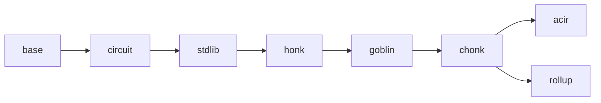

# bb-ref

A minimal, single-threaded Rust reimplementation of [barretenberg]'s UltraHonk and Chonk
(client IVC) provers and verifiers — **gate-exact and byte-exact** against a pinned bb
commit. Every circuit bb-ref builds reproduces bb's verification keys bit-for-bit; every
non-ZK proof it produces is byte-identical to bb's.

bb-ref exists to answer, by construction, the question _"what is the actual protocol?"_ —
separating the proving system's essential content from barretenberg's engineering
(templates, codegen, SIMD, parallelism, memory layouts). It is ~7 k lines of `src/`
against the ~350 k C++ lines on the equivalent bb paths.

[barretenberg]: https://github.com/AztecProtocol/aztec-packages/tree/master/barretenberg

## The pin

bb-ref tracks one bb commit, recorded in [`tools/PIN`](tools/PIN). Every doc comment
that cites a bb source path (`bb \`bigfield*impl.hpp\``) means *that file at the pin*.
Re-pinning is a deliberate procedure: regenerate all fixtures against the new commit
(`tools/regen/regen_*.sh`), re-run the full suite, and chase any drift with the tools in
[docs/oracle.md](docs/oracle.md).

## Status

| Ladder      | Scope                                                                                                                                                                       | State                                           |
| ----------- | --------------------------------------------------------------------------------------------------------------------------------------------------------------------------- | ----------------------------------------------- |
| M0–M20      | Client side: UltraHonk (+ZK), Mega flavors, HyperNova, Goblin (ECCVM, Translator, merge), Chonk IVC, ACIR ingestion, real protocol kernels, all 11 pinned transaction flows | **done** — proofs byte-exact, VKs bit-exact     |
| B0–B5       | Backend (prover-node) side: rollup tree circuits, in-circuit Ultra/CHONK/ROLLUP recursion, IPA accumulation + full in-circuit IPA, UltraKeccak (`rollup_root`)              | **done** — all 17 server circuit VKs byte-equal |
| B4-exit, B6 | Real-witness proofs for the recursion circuits; end-to-end rollup tree on harvested fixtures                                                                                | in progress (blocked on witness harvest)        |

Out of scope, permanently: the AVM (public-transaction execution), Solidity verifier
generation, Starknet oracle hash.

## Layout

One crate; layering is enforced by review, not the build system — each module depends
only on those left of it:



| module                   | contents                                                                                         |
| ------------------------ | ------------------------------------------------------------------------------------------------ |
| [`base`](src/base)       | field/group traits over arkworks, Poseidon2 & Keccak transcripts, codecs, SRS, polynomials       |
| [`circuit`](src/circuit) | the one builder (Ultra + Mega), trace blocks, op queue, databus, plookup tables                  |
| [`stdlib`](src/stdlib)   | in-circuit types: `FieldT`, bigfield, biggroup, `cycle_group`, goblin elements, Poseidon2 gadget |
| [`honk`](src/honk)       | flavors-as-data, relations, sumcheck, Shplemini/KZG, Oink, Ultra prover/verifier, HyperNova      |
| [`goblin`](src/goblin)   | merge, IPA/TripleIPA, ECCVM, Translator                                                          |
| [`chonk`](src/chonk)     | the IVC driver, joint MegaZK+Translator proof, kernel circuit logic                              |
| [`acir`](src/acir)       | ACIR ingestion, protocol-opcode lowering, recursion constraints, write-VK mocks                  |
| [`rollup`](src/rollup)   | backend-side recursion: in-circuit Ultra verifier, IPA accumulation, RollupIO                    |

Two documents are cross-cutting and required reading before touching prover/verifier or
stdlib code:

- **[docs/tour.md](docs/tour.md)** — start here: "life of a proof", the whole system in
  four acts, no math required.
- **[docs/gate-exactness.md](docs/gate-exactness.md)** — why the code sometimes computes
  the same thing twice on purpose, and why you must not "clean it up".
- **[docs/oracle.md](docs/oracle.md)** — how correctness is established (differential
  fixtures, the bb-side dumper, the debugging toolkit). _(to be written)_

## Running the oracles

```sh
cargo test --release                 # the full differential suite (~10 min)
cargo test --release --test b0_backend backend_vk_hash_sweep   # all server VKs vs bb
```

Small fixtures are committed under `tests/data/<pin7>/`; large ones regenerate via
`tools/regen/regen_*.sh`, which build the pinned bb test dumper (`BbRefDump`, a commit on the pin branch) inside
a checkout of the pin. Tests assert the fixture pin matches `tools/PIN`.
