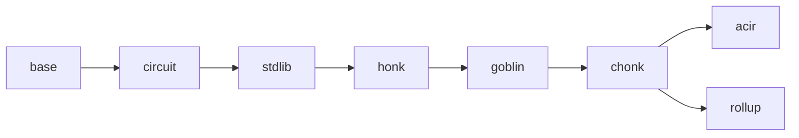

# bb-ref

A minimal Rust reimplementation of [barretenberg]'s proving stack — UltraHonk (+ZK, +Keccak,
+Rollup), Chonk (client IVC: HyperNova + Goblin), and the full rollup recursion — **gate-exact
and byte-exact** against a pinned bb commit. It exists to answer, by construction, *"what is the
actual protocol?"*: separating the proving system's essential content from barretenberg's
engineering, and to stand as an independent implementation that could eventually replace it.

[barretenberg]: https://github.com/AztecProtocol/aztec-packages/tree/master/barretenberg

## Goals

These are the project's binding goals — changes should be judged against them:

| goal | state |
| --- | --- |
| **Minimum lines of code** for a bit-parity reference implementation, in modern idiomatic Rust | **19.1%** of bb's C++ implementation (`tools/loc.sh`) |
| **Lean on stable, mature dependencies** instead of handwriting (fields/curves: arkworks; msgpack: rmp-serde; parallelism: rayon) | holds — no handwritten field or curve arithmetic |
| **Bit parity**: VKs bit-exact, proofs byte-exact, both directions, including the wire protocol | holds — every VK and pinned flow byte-equal |
| **Circuit gate parity**: every selector, wire and copy-cycle identical to bb's ([docs/gate-exactness.md](docs/gate-exactness.md)) | holds — enforced by the write-VK oracles and stdlib micro-oracles |
| **Replay the rollup through bb and bb-ref and get the same root proof** | holds — 62/62 corpus responses byte-identical, `rollup_root` included (`tools/conformance.sh`) |
| **Performance**: within 2× of bb, reducing to ≤ 1.2× in the near future | exceeded: against pin bb, rollup corpus **0.46×**, chonk native **0.48×**, chonk wasm/V8 **0.68×** wall; against the chonk-golf-patched bb, chonk native 0.92×, wasm 0.94× ([bench-results/](bench-results/), [docs/performance.md](docs/performance.md)) |
| **95%+ test coverage on the critical paths**, without redundant tests | core **95%** standalone, plus full soundness sweeps ([docs/testing.md](docs/testing.md)) |
| **Documentation an engineer can descend**: each component's purpose without the math; first use of any odd name links to its explanation | [tour](docs/tour.md) → module READMEs → [glossary](docs/glossary.md) |
| **A maintenance process for bb divergence**: diagnose and resolve drift quickly as bb moves | the pin + regen + divergence ladder ([docs/oracle.md](docs/oracle.md)) |

Out of scope at this time: the AVM (public-transaction execution) — bb-ref solves for pure
private-tx rollups. Also out of scope: Solidity verifier generation, Starknet oracle hash.

## The pin

bb-ref tracks one bb commit, recorded in [`tools/PIN`](tools/PIN) (a branch carrying a handful of
reviewable test-support commits: the seeded RNG, the frame-draw counter, envelope framing, the
instance dumper). Every doc comment citing a bb source path means *that file at the pin*.
Re-pinning: update the pin, `tools/regen/regen_corpus.sh`, re-run the suites, chase drift
with [docs/oracle.md](docs/oracle.md)'s ladder.

## Layout

One crate; layering is enforced by review, not the build system — each module depends only on
those left of it. Every module directory has a README covering its purpose, how it fits, and how
it works — start at [docs/tour.md](docs/tour.md) for the narrative, descend into the module
READMEs for detail:



| module | contents |
| --- | --- |
| [`base`](src/base/README.md) | field/group traits over arkworks, Poseidon2 & Keccak transcripts, codecs, SRS, polynomials |
| [`circuit`](src/circuit/README.md) | the one builder (Ultra + Mega), trace blocks, op queue, databus, plookup tables |
| [`stdlib`](src/stdlib/README.md) | in-circuit types: `FieldT`, bigfield, biggroup, `cycle_group`, goblin elements |
| [`honk`](src/honk/README.md) | flavors-as-data, relations, sumcheck, Shplemini/KZG, Oink, Ultra prover/verifier, HyperNova |
| [`goblin`](src/goblin/README.md) | merge, IPA/TripleIPA, ECCVM, Translator |
| [`chonk`](src/chonk/README.md) | the IVC driver, joint MegaZK+Translator proof, kernel circuit logic, proof compression |
| [`acir`](src/acir/README.md) | ACIR ingestion, protocol-opcode lowering, recursion constraints, write-VK mocks |
| [`rollup`](src/rollup/README.md) | backend-side recursion: in-circuit Ultra verifier, IPA accumulation, RollupIO |
| [`msgpack`](src/msgpack/README.md) | bb's wire protocol: generated types + the command handler (`bb-ref msgpack run`) |
| [`tests/`](tests) | differential suites (vs `tests/data/` fixtures) + standalone soundness/relations suites |
| [`tools/`](tools/README.md) | the commands below, their support libs, and the fixture regenerators |

## Commands

```sh
tools/regen/regen_corpus.sh          # rebuild the corpus from the pinned tree (produce-only)
tools/conformance.sh <corpus.zst>    # replay it into bb-ref vs recorded bb goldens, byte compare
tools/bench.sh <corpus.zst> --both   # per-operation timings, bb vs bb-ref (--threads <n>)
tools/bench_chonk.sh                 # client-IVC proving over the pinned tx flows, bb vs bb-ref
tools/check.sh                       # the standalone gate: unit tests with no bb, corpus, or fixtures
tools/coverage.sh                    # line coverage of the standalone test set
tools/loc.sh [--no-tests]            # bb C++ vs bb-ref Rust, side by side
cargo test --release                 # everything: differential + standalone (~10 min)
```

A **corpus** is the exact wire bytes a real prover sent to bb, replayable into either
implementation with nothing in between — see [tools/README.md](tools/README.md).

## Documentation

- **[docs/tour.md](docs/tour.md)** — start here: "life of a proof", the whole system in four
  acts, almost no math.
- **[docs/glossary.md](docs/glossary.md)** — every funny name (Shplemini, Oink, wNAF, …) in
  three sentences: what, why, where.
- **[docs/gate-exactness.md](docs/gate-exactness.md)** — why the code sometimes computes the same
  thing twice on purpose, and why you must not "clean it up".
- **[docs/oracle.md](docs/oracle.md)** — how correctness is established: differential fixtures,
  the bb-side dumper, the divergence-hunting ladder.
- **[docs/conformance.md](docs/conformance.md)** — the corpus design: capture, replay, seeds and
  thread policy, the msgpack server.
- **[docs/testing.md](docs/testing.md)** — the two-layer test structure (differential vs
  standalone), the soundness checklist, coverage.
