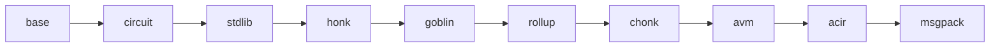

# bb-ref

A minimal Rust reimplementation of [barretenberg]'s proving stack — UltraHonk (+ZK, +Keccak,
+Rollup), Chonk (client IVC: HyperNova + Goblin), and the full rollup recursion — **gate-exact
and byte-exact** against a pinned bb commit. It exists to answer, by construction, *"what is the
actual protocol?"*: separating the proving system's essential content from barretenberg's
engineering, and to stand as an independent implementation that could eventually replace it.

[barretenberg]: https://github.com/AztecProtocol/aztec-packages/tree/master/barretenberg

## Goals

These are the project's binding goals — changes should be judged against them:

| goal | state |
| --- | --- |
| **Minimum lines of code** for a bit-parity reference implementation, in modern idiomatic Rust | **22.4%** of bb's C++ implementation (`tools/loc.sh`) |
| **A test suite under 30 s**: the default run (`cargo nextest run --release`) keeps every differential test's smallest real cases; `BBREF_FULL=1` adds every full-size byte-exactness case | **12 s**, 235 tests, on the shared dev box under load at nice 19 |
| **Lean on stable, mature dependencies** instead of handwriting (fields/curves: arkworks; msgpack: rmp-serde; parallelism: rayon) | holds, with one deliberate exception: the hot field kernels (ADX and IFMA Montgomery multiply, bb's wasm 29-bit and wide multiplies, Bernstein–Yang inverse) and the MSM are ported from bb for speed; arkworks still supplies the field and curve framework, the pairing and G2 ([src/base](src/base/README.md)) |
| **Bit parity**: VKs bit-exact, proofs byte-exact, both directions, including the wire protocol | holds — every VK and pinned flow byte-equal |
| **Circuit gate parity**: every selector, wire and copy-cycle identical to bb's ([docs/gate-exactness.md](docs/gate-exactness.md)) | holds — enforced by the write-VK oracles and stdlib micro-oracles |
| **Replay the rollup through bb and bb-ref and get the same root proof** | holds — 63/63 `rollup-1117683` corpus responses byte-identical, `rollup_root` included, and 28/28 of the AVM corpus (prove, check circuit, verify) with a `bb-avm` build (`tools/conformance.sh`) |
| **At parity or better with bb in performance, memory usage and wasm size** (against stock bb at the pin) | time: **0.46×** native, **0.68×** wasm; wasm memory **0.81–0.94×**; wasm module **2.1× smaller**; native memory **0.77–0.88×** ([results](#results), [docs/performance.md](docs/performance.md)) |
| **95%+ test coverage on the critical paths**, without redundant tests | core **95%** standalone, plus full soundness sweeps ([docs/testing.md](docs/testing.md)) |
| **Documentation an engineer can descend**: each component's purpose without the math; first use of any odd name links to its explanation | [tour](docs/tour.md) → module READMEs → [glossary](docs/glossary.md) |
| **A maintenance process for bb divergence**: diagnose and resolve drift quickly as bb moves | the pin + regen + divergence ladder ([docs/oracle.md](docs/oracle.md)) |

bb-ref proves and verifies the AVM (public-transaction execution), natively, and verifies it
in-circuit, so it builds and proves the public tx base rollup, which recursively verifies one
through bb's two-layer AVM verifier ([src/avm](src/avm/README.md)). The AVM's simulation and trace
generation stay bb's: native builds with `--features bb-avm` link them in-process
(`libbb-avm-sim.a`: `./pin/build.sh --avm-lib` first; bb's release toolchain, zig 0.15.1, and the
system libc++ to link it) for the three AVM commands, so one binary serves the whole prover. Out of scope at this
time: Solidity verifier generation, Starknet oracle hash.

## Results

Chonk (client IVC) proving over the 11 pinned transaction flows, stock bb at the pin against
bb-ref, both seeded, 8 threads, on a 16-core Zen 4 box (bbbench). Time is wall, best of 3; ratio is
bb-ref / bb, below 1 is better. Wasm runs under V8 (node 24, worker threads and shared memory, the
browser's shape); its memory is the wasm linear-memory peak, native's is peak RSS. Every bb-ref
proof is byte-identical to bb's. Measured 2026-10-23, pin `1117683`, bb-ref `7c9e511`, except native
memory, re-measured 2026-10-28 with the big-block arena (same box and method; that run's wall total
was 0.47×); tables of record in [bench-results/](bench-results/), method in [docs/performance.md](docs/performance.md).

| flow | native bb | bb-ref | ratio | native mem bb | bb-ref | wasm bb | bb-ref | ratio | wasm mem bb | bb-ref |
| --- | ---: | ---: | ---: | ---: | ---: | ---: | ---: | ---: | ---: | ---: |
| deploy_ecdsar1 | 3.12 s | 1.52 s | 0.49× | 0.25 GB | 0.22 GB | 5.68 s | 4.29 s | 0.76× | 0.23 GB | 0.20 GB |
| deploy_schnorr | 2.89 s | 1.40 s | 0.48× | 0.28 GB | 0.22 GB | 5.31 s | 4.02 s | 0.76× | 0.22 GB | 0.20 GB |
| amm_add_liquidity_1_recursions | 4.76 s | 2.37 s | 0.50× | 0.26 GB | 0.22 GB | 8.58 s | 6.28 s | 0.73× | 0.23 GB | 0.21 GB |
| ecdsar1 deploy_tokenContract | 3.66 s | 1.73 s | 0.47× | 0.26 GB | 0.23 GB | 6.50 s | 4.87 s | 0.75× | 0.24 GB | 0.21 GB |
| storage_proof_7_layers | 10.42 s | 4.00 s | 0.38× | 0.70 GB | 0.56 GB | 22.22 s | 10.67 s | 0.48× | 0.66 GB | 0.53 GB |
| token_bridge_claim_private | 3.16 s | 1.53 s | 0.48× | 0.26 GB | 0.22 GB | 5.83 s | 4.35 s | 0.75× | 0.23 GB | 0.21 GB |
| transfer_0_recursions, private_fpc | 4.16 s | 2.02 s | 0.49× | 0.26 GB | 0.23 GB | 7.45 s | 5.50 s | 0.74× | 0.24 GB | 0.21 GB |
| transfer_0_recursions | 2.76 s | 1.33 s | 0.48× | 0.25 GB | 0.21 GB | 5.10 s | 3.87 s | 0.76× | 0.22 GB | 0.20 GB |
| transfer_1_recursions, private_fpc | 4.43 s | 2.14 s | 0.48× | 0.26 GB | 0.22 GB | 7.83 s | 5.77 s | 0.74× | 0.25 GB | 0.21 GB |
| transfer_1_recursions | 3.07 s | 1.46 s | 0.48× | 0.25 GB | 0.22 GB | 5.59 s | 4.22 s | 0.75× | 0.22 GB | 0.20 GB |
| schnorr deploy_tokenContract | 3.40 s | 1.62 s | 0.48× | 0.27 GB | 0.23 GB | 6.08 s | 4.59 s | 0.75× | 0.23 GB | 0.21 GB |
| **total** | **45.83 s** | **21.12 s** | **0.46×** | | | **86.17 s** | **58.43 s** | **0.68×** | | |

Flows use the sponsored fee payer unless marked `private_fpc`, and an ecdsar1 account unless
marked schnorr. With wasm wide arithmetic (node 27 nightly), bb-ref's wasm total drops to 0.56×.

**Wasm module size** (what the browser downloads): bb.js-api's threads module is 18.15 MB
(4.03 MB gzipped); bb-ref.js's, Chonk-only and stripped, is **8.63 MB (2.12 MB gzipped)**.

Try it in a browser: **[charlielye.github.io/bb-ref](https://charlielye.github.io/bb-ref/)** proves
the same flows with both engines side by side ([js/](js/README.md)).

## The pin

bb-ref tracks one bb commit, recorded in [`tools/PIN`](tools/PIN): `cl/bb-ref-conformance`, bb's
`next` (at 2be71b2f5d, with the private-repo security batch) plus the generated bb.js-api package
and its `Init` command and wide-arithmetic modules (aztec-packages#25433), carrying a handful of
reviewable test-support commits (the seeded RNG and its draw tape, the frame-draw counter, envelope
framing, the instance dumper) and one fix to ipc-runtime's node wasm threads. Every doc comment citing a bb source path means *that file at the pin*.
Re-pinning: follow [docs/oracle.md § Re-pinning](docs/oracle.md#re-pinning), then chase drift
with its ladder.

## Layout

One crate; layering is enforced by review, not the build system — each module depends only on
those left of it, apart from test code and sumcheck's Translator hook. Every module directory has a README covering its purpose, how it fits, and how
it works — start at [docs/tour.md](docs/tour.md) for the narrative, descend into the module
READMEs for detail:



| module | contents |
| --- | --- |
| [`base`](src/base/README.md) | field/group traits over arkworks, Poseidon2 & Keccak transcripts, codecs, SRS, polynomials |
| [`circuit`](src/circuit/README.md) | the one builder (Ultra + Mega), trace blocks, op queue, databus, plookup tables |
| [`stdlib`](src/stdlib/README.md) | in-circuit types: `FieldT`, bigfield, biggroup, `cycle_group`, goblin elements |
| [`honk`](src/honk/README.md) | flavors-as-data, relations, sumcheck, Shplemini/KZG, Oink, Ultra prover/verifier, HyperNova |
| [`goblin`](src/goblin/README.md) | merge, IPA/TripleIPA, ECCVM, Translator |
| [`chonk`](src/chonk/README.md) | the IVC driver, joint MegaZK+Translator proof, kernel circuit logic, proof compression |
| [`acir`](src/acir/README.md) | ACIR ingestion, protocol-opcode lowering, recursion constraints, write-VK mocks |
| [`avm`](src/avm/README.md) | the AVM prover, verifier (native and in-circuit: bb's two-layer recursive verifier) and circuit check, over relation tables generated from bb-pilcom's output |
| [`rollup`](src/rollup/README.md) | backend-side recursion: in-circuit Ultra verifier, IPA accumulation, RollupIO |
| [`msgpack`](src/msgpack/README.md) | bb's wire protocol: generated types + the command handler (`bb-ref msgpack run`) |
| [`tests/`](tests) | differential suites (vs `tests/data/` fixtures) + standalone soundness/relations suites |
| [`tools/`](tools/README.md) | the commands below, their support libs, and the fixture regenerators |
| [`js/`](js/README.md) | `bb-ref.js` (generated: bb.js-api's API over bb-ref's module) and a browser bench page comparing the two ([live](https://charlielye.github.io/bb-ref/)) |

## Commands

```sh
tools/regen/regen_corpus.sh          # rebuild the corpus from the pinned tree (produce-only)
tools/conformance.sh <corpus.zst>    # replay it into bb-ref vs recorded bb goldens, byte compare
tools/bench.sh <corpus.zst> --both   # per-operation timings, bb vs bb-ref (--threads <n>)
tools/bench_chonk.sh                 # client-IVC proving over the pinned tx flows, bb vs bb-ref
tools/bench_chonk_wasm.sh v8         # the same on wasm (v8 or wasmtime)
tools/check.sh                       # the standalone gate: warning-free build + unit tests, no bb or fixtures
tools/coverage.sh                    # line coverage of the standalone test set
tools/loc.sh [--no-tests]            # bb C++ vs bb-ref Rust, side by side
tools/build_bb_ref_js.sh             # generate + build js/bb-ref.js; then node js/chonk-bench/serve.mjs
node js/chonk-bench/build-site.mjs --publish   # publish the bench page to GitHub Pages
cargo nextest run --release          # the suite: differential + standalone, smallest real cases (<30 s)
BBREF_FULL=1 cargo nextest run --release   # plus every full-size byte-exactness case
```

A **corpus** is the exact wire bytes a real prover sent to bb, replayable into either
implementation with nothing in between — see [tools/README.md](tools/README.md).

## Documentation

- **[docs/tour.md](docs/tour.md)** — start here: "life of a proof", the whole system in four
  acts, almost no math.
- **[docs/glossary.md](docs/glossary.md)** — every funny name (Shplemini, Oink, wNAF, …) in
  three sentences: what, why, where.
- **[docs/gate-exactness.md](docs/gate-exactness.md)** — why the code sometimes computes the same
  thing twice on purpose, and why you must not "clean it up".
- **[docs/oracle.md](docs/oracle.md)** — how correctness is established: differential fixtures,
  the bb-side dumper, the divergence-hunting ladder.
- **[docs/conformance.md](docs/conformance.md)** — the corpus design: capture, replay, seeds and
  thread policy, the msgpack server.
- **[docs/testing.md](docs/testing.md)** — the two-layer test structure (differential vs
  standalone), the soundness checklist, coverage.
- **[docs/performance.md](docs/performance.md)** — where bb-ref stands against bb, how to
  reproduce the numbers, which optimizations own them.
